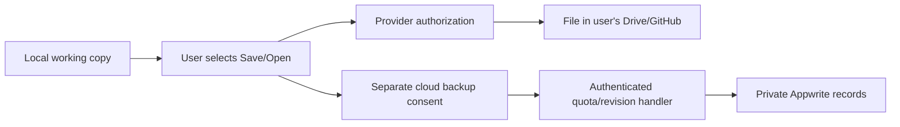

# Consent, architecture and rollout

Research/design plus branch implementation status, updated 2026-10-28. Read with the account limits and feature-gap review. A feature marked implemented is source code on the current branch; it is not provisioned or deployed until the live proof gates pass.

## Data contract

Normal notes remain in local IndexedDB/browser storage. No Markup note title/content, image, local history or AI chat is uploaded by default. Opening the editor should not create an anonymous backend account. Optional sign-in necessarily stores identity and session/security metadata; explain that accurately.

| Action | Explicit scope |
|---|---|
| Sign in | Minimal account/session metadata; no note migration |
| Connect Drive | Named provider account and selected-file authorization |
| Connect GitHub | Named account and selected repository installation |
| Save to provider | User confirms file/repository/branch/path and content being sent |
| Enable cloud backup | Selected notes, displayed quota/retention, unchecked by default |
| Include media/history | Separate selection and counted bytes |
| Create share link | Separate upload, visibility, expiry and revoke choice |
| Sync preferences | Whitelist themes/fonts/modes; exclude all secrets |

Disable-sync, disconnect-provider and delete-cloud-copy are different operations. Server handlers must check current consent. Logout/account switching must cancel in-flight requests and partition remote caches/outboxes so user B cannot submit user A's queued changes. Clearly offer whether local copies are retained, and provide export before destructive deletion.

Provider-only mode can store minimal identity/connection/consent metadata in Appwrite without a document mirror. If a Function relays a save, selected plaintext transits that server. Verify platform request/execution retention before promising no retained document copies. No document/token/provider response bodies should be written to application logs.

## Google Drive

Use `drive.file` plus Google Picker for ordinary, user-visible Markdown files. Avoid full `drive`/`drive.readonly`. `drive.appdata` is hidden application storage: suitable only for a separately explained settings/backup option. [Drive scopes](https://developers.google.com/workspace/drive/api/guides/api-specific-auth), [app data](https://developers.google.com/workspace/drive/api/guides/appdata).

Start with foreground authorization and manual Save/Open. Google's browser token model supplies short-lived tokens and user-driven renewal without backend refresh-token custody. Background sync needs authorization-code/offline access, secure token storage, reconnect/revoke and remote change tracking. [Token model](https://developers.google.com/identity/oauth2/web/guides/use-token-model), [server OAuth](https://developers.google.com/identity/protocols/oauth2/web-server).

Appwrite Google login and Drive file authorization are separate product choices. The provider app/callback/scopes must be configured. An Appwrite session may stay valid after a provider token expires; refresh only works when the provider supplied the required refresh token. [Appwrite OAuth](https://appwrite.io/docs/products/auth/oauth2).

Track linked account, file ID and remote base revision. Preserve both copies on conflict. The initial adapter saves new copies only; existing-file overwrite stays disabled until the provider POC proves that Drive v3 honors `If-Match` and rejects a stale ETag. Timestamp checking alone does not guarantee atomic protection. Disconnect revokes the grant/removes credentials and should not delete the user's provider files by default.

## GitHub

Prefer a Markups GitHub App, selected repositories, Contents read/write and necessary metadata access. Avoid broad OAuth `repo`, workflow or admin access. Appwrite sign-in does not register or install this App. [Apps vs OAuth](https://docs.github.com/en/apps/oauth-apps/building-oauth-apps/differences-between-github-apps-and-oauth-apps).

Show repository/branch/path/diff/commit message before each write. Track the existing blob SHA and return a conflict when it changed. Preserve local text and respect branch protection; offer a new branch/PR where appropriate. Validate server-side that the installation/repository belongs to the acting user. [Contents API](https://docs.github.com/en/rest/repos/contents).

Keep the GitHub App private key in server secrets and mint installation tokens on demand; these tokens expire after one hour. Verify webhook HMAC for uninstall, repository removal and permission changes. [Installation tokens](https://docs.github.com/en/rest/apps/apps).

## Proposed resources and permissions

Start with one serverless TablesDB database; add one Storage bucket only in the media/share phase. Fit within two Functions initially: `connector-api` and `cloud-api`. No dedicated database, SMS, paid add-on or frontend-hosting migration is needed.

| Table | Responsibility |
|---|---|
| `consents` | Purpose/version/scope and granted/revoked times; minimal evidence; server writes |
| `connections` | Owner/provider/installation mapping; owner read; server write |
| `connection_secrets` | Only for necessary persistent credentials; server-only ACLs plus application encryption |
| `documents` | Stable UUID, owner, title/content, byte count/hash/revision; owner read, server mutations |
| `versions` | Owner/document/revision/expiry/payload, counted in the user quota |
| `usage` | Byte/count/revision budgets; owner-readable projection, trusted server writes |
| `operations` | Idempotency, bounded reservations, completion/failure; minimal retention |
| `shares` (later) | Snapshot, hashed capability, expiry/revocation; server resolves access |

Validate actual TablesDB text sizes, encryption, indexes and transaction behavior before finalizing the schema. Never use user preferences as a token vault. Platform encryption and private ACLs are not client-side end-to-end encryption; E2EE would require separate key recovery, sharing and search design.

Owner row/file permissions need row/file security enabled and no broad parent-table/bucket grants. Permissions are additive. Quota-controlled resources must deny direct client mutations/uploads that bypass server accounting. Server keys can bypass ACLs, so every handler must derive/verify user identity, ownership and consent itself. Generated Function URLs are not authentication. [Permissions](https://appwrite.io/docs/advanced/security/permissions), [storage permissions](https://appwrite.io/docs/products/storage/permissions), [Function authentication](https://appwrite.io/docs/products/functions/execute).

## Quota and revision protocol

1. Authenticate session/JWT and derive the owner server-side; validate current consent, operation type and UTF-8 byte length. Require the client's expected base revision.
2. For text-note saves, guard the expected revision inside the same protected transaction/concurrency protocol as the document, user/global quota and idempotency changes. A preflight revision read alone is insufficient. Appwrite transaction conflicts do not automatically validate an application `expectedRevision` field; prove the guard in the POC. Do not trust client owner/quota/byte claims.
3. Commit the new revision, optional bounded version and accounting only while that base remains valid. Retry transaction/accounting contention only after rechecking the base. A stale client must get a conflict with its local copy preserved, never a silent overwrite. Bind idempotency to owner, target, operation and payload hash; identical retries return the same result without double-counting, and changed-payload reuse is rejected.
4. Preserve local content on auth/quota/conflict/outage failures. Release reservations idempotently and reconcile stale operations.
5. Storage/provider writes are outside the database transaction: use staged upload/finalization and compensating cleanup, with counted reservations. No cross-service atomicity promise.

Validate race behavior with two simultaneous near-limit saves before claiming a hard quota. Monitor physical platform usage independently of logical content bytes. [Transactions](https://appwrite.io/docs/products/databases/tablesdb/transactions), [atomic operators](https://appwrite.io/docs/products/databases/tablesdb/operators).

## Integration and lifecycle safeguards

- Lazy-load account/cloud modules; optional backend outages must not block local boot. Display local and cloud status independently.
- Only endpoint/project ID belong in frontend config. Admin/provider secrets must never be `VITE_*`, browser storage, bundles or user-readable rows.
- Allow exact production/local/approved-preview hosts and callbacks. Avoid blanket `vercel.app` authorization. Test session-cookie behavior with third-party cookies blocked; evaluate a custom API domain where needed.
- Narrow CSP endpoints; exclude authenticated proxy APIs from SW/CDN caches and use private/no-store headers.
- Prefer local binary storage improvements first. Future private cloud media needs explicit consent, signature/extension limits and safe rendering. Bucket encryption/antivirus/compression have large-file limitations, so platform maximum upload size is not an appropriate app limit. [Bucket controls](https://appwrite.io/docs/products/storage/buckets), [encryption](https://appwrite.io/docs/advanced/security/encryption).
- Account deletion must revoke connections, close subscriptions and remove owned rows/files/shares with retryable cleanup; explain backup retention. Auth deletion alone is insufficient.
- Partition outbox/caches by project/account. Use stable IDs, base revisions, tombstones, idempotency, backoff and conflict copies. Realtime is a notification channel, not CRDT/OT or an offline queue. [Offline sync](https://appwrite.io/docs/products/databases/tablesdb/offline), [Realtime auth](https://appwrite.io/docs/apis/realtime/authentication).

## Optional sharing and schedules

Keep the existing no-server share. A cloud share requires separate upload consent, a small snapshot, proposed 24-hour TTL and three active shares/user, all counted in quota. Private tables/buckets plus a server capability check avoid public blanket ACLs. Use a high-entropy secret and store its hash; redact secrets from referrers/logs. Explain bearer-link access and allow revoke. Enforce expiry on every read even if cleanup is delayed.

The live plan reports cron disabled and minimum interval 60 minutes. Current official pages also describe Free/Education schedule behavior; validate the account's actual allowed interval instead of promising exact-time jobs. [Function configuration](https://appwrite.io/docs/products/functions/functions), [execution/scheduling](https://appwrite.io/docs/products/functions/execute).

## Implementation phases and proof gates

The first local implementation slice and local E2E/browser verification are complete. Live-service POCs remain outstanding; deployment is not authorized or performed by this work.

| Phase | Branch status | Proof before rollout |
|---|---|---|
| 0 — account | **Blocked on Appwrite Console sign-in and write access.** Existing project/plan research is documented; the requested empty `Markup` project was not created. | Sign in to the connected Appwrite Console, create/read back the project, then verify region/plan/expiry and permitted use; no unintended billing changes |
| 1 — local foundation | **Implemented.** Note-scoped history, local media blobs, portable export/share payloads and account-partitioned cloud links are in source. | Browser migration, cross-note restore, large/media export and account-switch regression |
| 2 — identity/consent | **Implemented, unconfigured.** Lazy SDK, optional auth, per-note consent, manual save, cloud list/open/delete/sign-out and data deletion flow. Each cloud request validates the exact user JWT against the UI's captured account ID before calling the Function; local account state is cleared when a switch is observed. | Appwrite OAuth/domain, zero-implicit-upload, multi-tab/session-expiry behavior and revocation against a real project |
| 3 — foreground providers | **Implemented, unconfigured.** Drive picker and new-copy Save/Open; existing-file update is disabled until conditional-write behavior is proven. GitHub selected-repo/SHA flow is bound to the initiating Markups user ID. | Provider credentials, real token expiry/revoke, end-to-end account mismatch, Google concurrent-write behavior, protected branch and remote conflict tests |
| 4 — private pilot | **Implemented but disabled.** Text-only API, per-user/pilot limits, revision/idempotency logic and a schema/provisioning manifest. | Real TablesDB schema/transactions, private ACLs, JWT forwarding, near-limit concurrency, cleanup, usage and retained-version checks |
| 5 — sync/shares | **Not implemented.** Automatic sync, durable outbox, public cloud shares, cloud media, and shared editing remain out of scope. | Separate consent, architecture and abuse/recovery proof gates before starting |

The account connector can read project context, but its dedicated write gateway is still unavailable in this session. The owner chose that path; the Browser Use attempt ended at sign-in without changes, and the in-app browser now has the Appwrite sign-in page open. The empty project create is already authorized. The current $0 GitHub Student Pack plan has a two-project cap and a six-month term; Appwrite says Education use is educational/non-commercial and older accounts must choose a plan by 2026-11-01. Confirm eligibility/plan in Billing before using it for Markups' public production users. Live cloud rollout remains gated on sign-in, plan choice, project creation and POCs.
