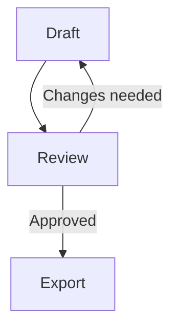

# Content and listing pack — prepared for owner review

Nothing in this file has been posted, sent or submitted. Verify the approved live destination before publishing. The existing DEV article already introduces Markups; use a useful follow-up or update rather than repeating the launch announcement.

## Reusable factual description

Markups is a free, open-source browser Markdown editor with Monaco source editing, live preview, Mermaid diagrams and KaTeX math. The core editor requires no account. Normal drafts stay in browser storage; optional AI Writer sends selected text to the configured provider. Export options include Markdown, standalone HTML, image-based PDF and Word-compatible HTML saved as .doc. Native DOCX and selectable PDF text are not promised. Website: https://markups.dev/ . Source: https://github.com/Nir-Bhay/markups .

## Draft 1: A README test that catches more than a paragraph of Markdown

**Suggested channel:** follow-up on DEV, with maintainer disclosure. Do not duplicate the existing introduction. Adapt the title after reviewing actual screenshots. Link the published on-site source as canonical only if it is the substantially equivalent original; do not canonicalize a distinct tutorial to an unrelated homepage.

I maintain Markups, a browser Markdown editor. When checking a Markdown workflow, I prefer a small realistic document to a screenshot of a heading and a bullet list.

A useful test document contains a table, a fenced code block, a diagram and a formula. Those features expose different problems: table wrapping, code escaping, diagram layout and math rendering. A document can look fine in the editor and still need work after export.

Start with a local copy of the fixture linked from the [Compatibility Lab](https://markups.dev/seo/compatibility-lab). Keep that Markdown file as the source of truth. Open the editor, paste or import the source, and check each section in the preview. If you change the diagram, confirm that the diagram changes too. If you edit the source table, inspect its narrow-screen layout.

Here is a small diagram you can use as an additional check:

````markdown

````

Next, export the document in the format you actually need. Reopen that exported file. Inspect the table, the diagram, the formula and the code; do not assume a successful download means the document is ready for someone else.

Markups currently generates image-based PDF, so selectable text and clickable links are not guaranteed. The Word option is Word-compatible HTML saved as .doc, not native .docx. For an editable handoff, keeping the original .md alongside the export is useful.

The point of this test is a repeatable check, not a claim that every editor should behave identically. If you find a failure, report the smallest example, browser/version, chosen export format and what you expected. Share only content you have permission to publish.

**Before posting:** insert two authentic screenshots from the reviewed build (source plus preview, and opened export), label the tested commit/browser/date, and remove any claim not covered by that test. Do not call this a competitor benchmark.

## Draft 2: Choose the handoff format before exporting your Markdown

**Suggested channel:** improve the relevant on-site guides first; adapt a short LinkedIn demonstration later. Maintainer disclosure: this example uses Markups, which I maintain.

The first question before exporting is what the next person needs to do with the document. Read it? Edit it? Publish it? Search and select the text? Those tasks can require different formats.

| Recipient's job | Format to consider | Check before sending |
|---|---|---|
| Continue editing the source | Markdown .md | Does the recipient support your Mermaid and math syntax? |
| Read rendered content in a browser | Standalone HTML | Open the file separately; check styles, diagrams and external assets |
| Review a fixed visual snapshot | Current image-based PDF | Check pagination and diagram clarity; do not assume selectable text or clickable links |
| Open in a Word-compatible workflow | Current HTML-based .doc | Test in the recipient's application; this is not native DOCX |

In Markups, keep a copy of your original Markdown and export a small sample first. Use a document with the elements you care about: a wide table, a diagram, a formula or a long code block. Open the result in the application your recipient will use.

A valid file header only proves that a file has the expected basic format. It does not prove that page breaks are useful, links work or the result is accessible. The Compatibility Lab includes source you can reuse and a checklist for checking output.

If selectable or accessible PDF text is a hard requirement, the current image-based export should not be described as meeting it without verification. Naming that limitation clearly is more useful than promising that every export matches the preview.

**Before posting:** verify each example on the owner-approved build, attach real output screenshots, and link to the specific relevant guide. Avoid a second generic 'best free editor' roundup.

## 45–60 second authentic demo outline

1. 0–8s: Open markups.dev and show no mandatory login for the core editor.
2. 8–22s: Paste the public fixture; show the source table and rendered table.
3. 22–35s: Edit one Mermaid label; show the changed diagram and a math expression.
4. 35–48s: Export one file and open it; state its actual format and relevant limitation.
5. 48–60s: Show the Compatibility Lab/source link and ask for one specific workflow failure to improve.

Record the actual app. No fabricated loading-time measurement, testimonials or AI recommendation screenshots.

## Minimal legacy URL correction draft

I maintain Markups. The project's canonical website is now https://markups.dev/; its source remains https://github.com/Nir-Bhay/markups. Please replace the existing markups.vercel.app website link with markups.dev. This is a URL correction to the existing entry, not a request for a ranking or endorsement.

Use the existing issue/thread where possible and follow that site's submission rules. This draft has not been sent.

## Feedback questions for real testers

- Could you open the editor and import the fixture without an account?
- Which diagram, formula or table did not render as expected? Include minimal source.
- Could you find the export format you needed? Did its label accurately describe the file?
- What failed on your browser/device? Record browser, OS and steps, not private document content.
- Would you use this for your actual README/docs work? What single missing behavior stops you?
