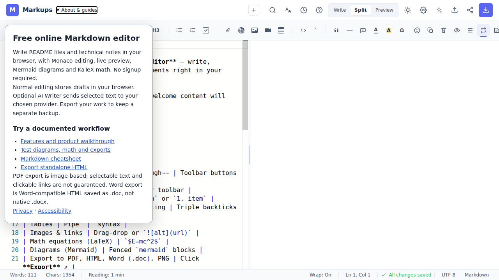
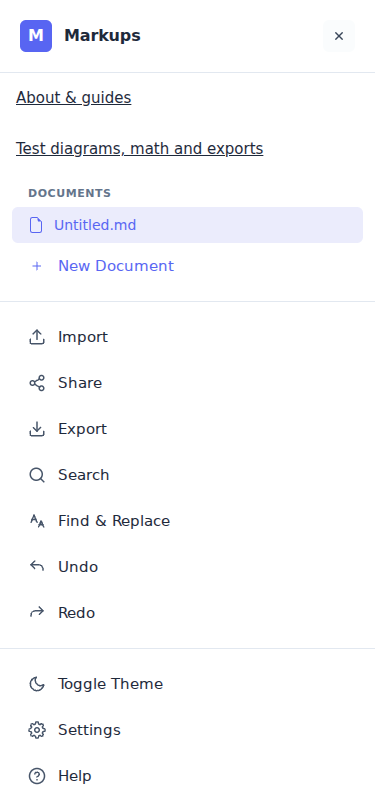

# Markups discovery review — 24 October 2026

Status: isolated source changes for owner review. No permission to publish, deploy, merge or change main. This report is not evidence of improved live rankings.

## Decision

Finish and verify the existing growth work, then improve useful technical content and correct existing third-party references. The site is discoverable on the web, but the connected Google performance data shows very little discovery. Product quality alone does not establish search relevance or independent citations. The evidence does not establish a penalty, deindexing, or a single root cause.

## Previous work recovered and checked

Repository: https://github.com/Nir-Bhay/markups
Main at review start: `9458092d60aa678e2bc8253f205bb56717a3fca6`.
Inherited growth head: `81155bcabd0ef7586529d4cd98d5ef751991eae0` on `growth/seo-geo-audit-2026-10`, draft PR #71.
New review branch: `growth/discovery-review-2026-10-24`, based on that growth head so prior improvements are retained.

The inherited last commit corrects the AI Writer canonical domain and removes misleading DOCX footer links. Its GitHub quality check succeeded: https://github.com/Nir-Bhay/markups/actions/runs/39988242957 . This is historical verification of that commit, not verification of this review's changes.

Inherited work includes rebuilt landing, legal-route build inputs, corrected OG assets, self-canonical landing, Compatibility Lab and fixture, activation events, truthful export labeling, static audits and browser tests. Main has none of those branch changes. Never restart by duplicating PR #71 or merge it automatically.

## Findings and response

| Finding | Evidence | Response in this branch | Remaining validation |
|---|---|---|---|
| Previous fixes are unreleased | Main and growth heads differ; PR #71 open/draft | Continue from inherited head | Owner review; release separately authorized |
| Export fidelity and unsupported syntax promises survived | Live-preview guide claimed exact PDF fidelity and definition lists | Correct prose and JSON-LD; link fixture; remove unsupported syntax claim | Inspect representative files in PDF/Word viewers |
| Performance/mobile guarantees lacked measurements | Online guide promised five-second start and universal iOS/Android installation | Remove fixed speed promise; qualify mobile support; align FAQ visibility/schema | Actual iOS/Android device QA and CWV |
| Product explanation was clipped to 1px | Root HTML `.crawl-summary` | Native keyboard-accessible About/details; mobile product/fixture links | Browser and visual checks recorded in run log |
| Analytics bootstrap loaded on arbitrary hosts | Root allowed every non-localhost | Canonical production hostname only | Production network and owner analytics checks after approval |
| Default analytics URL capture was uncontrolled | Shared docs use URL fragments; default GA config lacked overrides | Explicit query/fragment-free page_location; origin-only referrer; fixed product title | Network check in controlled analytics environment; no historical leak asserted |
| Document-mode activation was missing | Preview-edit path bypasses ordinary source-edit telemetry | Track first genuine changed preview edit | Browser event test and real GA4 confirmation after release |
| Editor replay masking was unverified | No explicit source masking; dashboard unavailable | Stop loading Clarity on editor pending owner review | Historical data/configuration not examined; this is not proof of capture |
| Browser QA tested dev source | Playwright always ran Vite dev, workflow overwrote production dist with modular | Built-preview mode; production tests before modular; branch-specific concurrency | CI on final commit; local alternative Chromium limitations recorded |
| Sitemap copies drifted | Root lacked Compatibility Lab; public build copy had 16 URLs | Synchronize copies and add drift gate | Production sitemap/Google canonical after authorized release |
| Existing mentions advertise legacy domain | Public Awesome list and search previews for LibHunt/old posts | Prepare correction tracker, owner actions and draft copy | No third-party edit or outreach sent |
| GSC has robots.txt submitted as sitemap | Connected sitemap data: errors on robots.txt entry; warning on sitemap.xml | Owner runbook retained and clarified | Remove submission entry only; investigate actual warning in UI |
| Google indexing coverage unknown | Search analytics API exposes impression rows, not coverage/inspection reasons | Keep unknown; request exact URL Inspection evidence | Do not equate four impression-bearing URLs with four indexed pages |
| Vercel scope insufficient | Project listed, scoped project detail returns 403 for `nirbhay-987s-projects` | Record blocker; no settings changed | Owner grants correct team access; then deployment/log/redirect/WAF review |

## Dependency and verification follow-through

The health gate exposed ten audited vulnerable package entries. The candidate updates the lockfile
and required ranges; installed verification versions include DOMPurify 3.4.17, Vite 6.4.5,
Vitest/coverage 4.1.12, Mermaid 12.2.0 and KaTeX 0.18.10 (peer-compatible 0.18 range).
The resulting npm audit reports zero findings; this is a dependency check, not an exploit audit.

The modular build previously produced byte-identical production-entry output. The Vite pre-hook now
selects the entry before HTML parsing, and generateBundle asserts the expected module and rejects
the opposite one. Paths are normalized for Windows. The true modular editor has a separate UI/route
smoke; full production-feature parity is not claimed.

Spellcheck's English dictionary is genuinely deferred to an idle dynamic import. Disabled startup
skips it, enabling schedules it, concurrent loads share one promise and failed initialization can
be retried. Production main JS falls from 1794.96 kB to about 1220.47 kB (uncompressed build sizes).
The 563.54 kB dictionary is still downloaded when needed. Mermaid 12 also has a separate optional
1477.47 kB ELK layout chunk; its explicit 1500 kB ceiling and no-home-preload gate are documented.
This is not a measured LCP/INP gain or a reduction of total eventual application bytes.

A browser regression exposed the long spellcheck menu dismissing during its own focus/scroll.
The menu now prevents focus-induced scrolling, ignores its own scroll, and still closes for
external scroll; a Node guard handles native Window event targets. Verification details and
any final CI status are in the run log.

## Private measurement interpretation

Search Console and GA4 were read through Windsor.ai on 24 October 2026. Exact owner account data is reported to the owner, not copied into this public repository. GA4 was verified by hostname and connected property rather than its generic project name. Other hostnames exist in that property, so unfiltered totals are unsuitable.

Use the same dates, property, hostname and dimensions for repeat pulls. Site/property aggregation and URL-level GSC aggregation produce different impression totals; never sum URL rows and label that the site total. Query rows omit anonymized queries. Sparse visible brand queries do not prove that every hidden query is branded. Average position with tiny volume is not a rank for 'best free Markdown editor'. Some GA4 referrals may be automated or spam; sessions are not verified humans or activations.

## Search and AI strategy

Primary intent: free online Markdown editor, no signup. Supporting intents: browser Markdown with Mermaid and KaTeX; preview README with diagrams; export Markdown to standalone HTML; understand image-based PDF limitations. Keep each useful route distinct and linked from the editor/product walkthrough. Keep unsupported comparison pages noindex until first-hand testing supports them.

Google's official guidance says ordinary SEO and useful original content apply to AI search; llms.txt and special schema do not create Google AI visibility. Maintain the existing reference file if useful, but do not spend the sprint treating it as a ranking mechanism. Google indexing, ChatGPT retrieval and Gemini/Perplexity recommendations are separate observations. No direct account-output benchmark was completed for those AI products in this review.

Sources checked:
- https://developers.google.com/search/docs/fundamentals/ai-optimization-guide
- https://developers.google.com/search/docs/appearance/ai-features
- https://developers.google.com/search/docs/fundamentals/how-search-works
- https://vercel.com/docs/project-configuration/git-configuration
- https://github.com/mundimark/awesome-markdown-editors
- https://www.libhunt.com/r/markups (search preview available; direct fetch 403)
- https://dev.to/nirbhay_hiwse/i-built-markups-a-free-open-source-markdown-editor-that-doesnt-need-an-account-5bb6

## Review entry points

- [Seven-day execution plan](SEVEN-DAY-PLAN-2026-10-24.md)
- [Owner-only actions](OWNER-ACTIONS-2026-10-24.md)
- [Content and correction pack](CONTENT-PACK-2026-10-24.md)
- [Distribution tracker](distribution-2026-10-24.csv)
- [Verification run](runs/2026-10-24-discovery-review.md)

## Limits and release boundary

This branch disables Vercel Git auto-deployment only for its own exact branch name. Other branch behavior is unchanged. Do not call deployment/preview/publish tools or enable deployment until the owner explicitly changes the instruction. GitHub Pages checks exist on the inherited old branch; their presence is not proof of a Vercel production release. New branch source is not selected as a Pages publishing branch in this work.

The seven-day goal is a verified release candidate and a completed discovery/distribution preparation sprint. Indexing and ranking cannot be fixed on a held branch. After owner approval, launch the live measurement window; if review takes longer, move the day numbers rather than pretend live improvements already occurred.

## Actual candidate screenshots

Synthetic welcome document only, captured from the local built candidate; these are not production or search-results screenshots.

