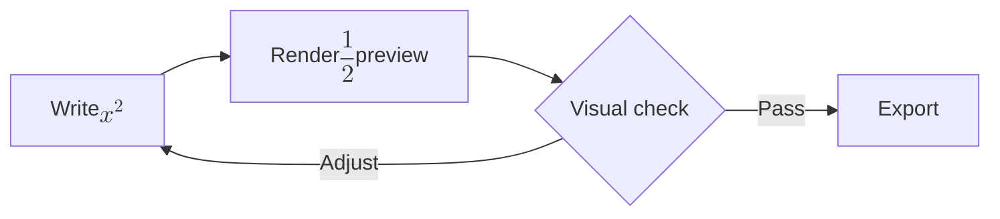

# Markdown compatibility fixture: API design note

A reproducible document for testing a browser Markdown preview. The content is synthetic; it contains no personal data or API secrets.

## 1. Feature checklist

- [x] Heading hierarchy and paragraphs
- [x] Task list and table
- [x] Fenced JavaScript example
- [x] Mermaid flowchart
- [x] Inline and display math

## 2. Endpoint response

| Field | Type | Required |
| :--- | :--- | :---: |
| request_id | string | Yes |
| elapsed_ms | number | Yes |
| status | string | Yes |

The latency budget is **250 ms** for the demo endpoint.

### Example response

```json
{
  "request_id": "demo-123",
  "elapsed_ms": 145,
  "status": "ok"
}
```

## 3. Rendering pipeline



## 4. A small calculation

The relative completion rate is $r = \frac{n_{\mathrm{done}}}{n_{\mathrm{total}}}$.

$$
\mathrm{estimated\_time} = \frac{N \times t}{60}
$$

## 5. Example code

```javascript
function percentage(done, total) {
  if (total <= 0) return 0;
  return Math.round((done / total) * 100);
}
```

## 6. Export checks

- [ ] Markdown: the downloaded file still contains the code fences and math delimiters.
- [ ] HTML: open the downloaded file in a browser and inspect headings and visual diagrams.
- [ ] PDF: inspect every page for clipping; current Markups PDF is image-based, not selectable text.
- [ ] Word: Markups saves Word-compatible HTML as \`.doc\`, not a native \`.docx\` archive.

> Rendering here is a reproducible sample, **not a claim that every Markdown dialect or all exports are fully compatible**.

For privacy: normal drafts stay in the browser; optional AI requests can send chosen content to a configured model endpoint.
